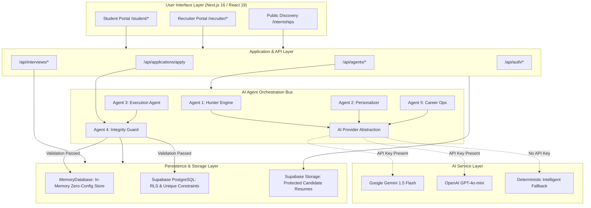
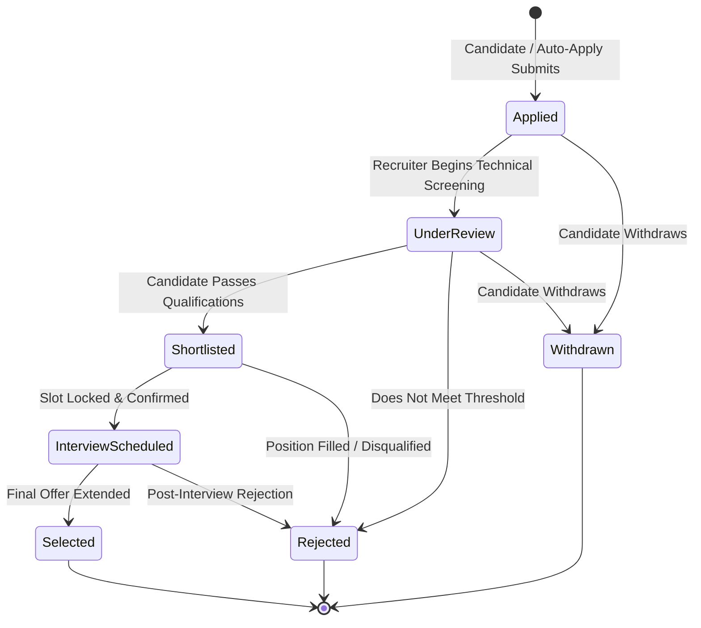

<div align="center">

# INTERNBRIDGE
### Intelligent Career & Recruitment Platform

**"Discover opportunities. Apply intelligently. Build your career."**

[](https://nextjs.org/)
[](https://react.dev/)
[](https://www.typescriptlang.org/)
[](https://tailwindcss.com/)
[](https://supabase.com/)
[](https://vitest.dev/)

[Explore Codebase](https://github.com/KjvRajesh11/internbridge) • [View Architecture](#product-architecture) • [Getting Started](#installation-and-local-development) • [Five AI Agents](#the-five-coordinated-ai-agents)

</div>

---

InternBridge is a full-stack, AI-assisted internship discovery and recruitment management platform that bridges the gap between emerging student engineers and hiring organizations. Built on Next.js 16, React 19, and Tailwind CSS v4, the system unifies student portfolio verification, multi-factor opportunity matching, structured recruiter pipelines, and atomic interview scheduling. At its core, five specialized AI agents automate repetitive application preparation while an uncompromising integrity engine enforces critical business rules—guaranteeing that students cannot apply to the same internship more than once.

---

## Table of Contents

- [Project Overview](#project-overview)
  - [The Problem Statement](#the-problem-statement)
  - [Why Traditional Workflows Fail](#why-traditional-workflows-fail)
  - [The InternBridge Solution](#the-internbridge-solution)
- [Key Features](#key-features)
  - [Student Experience](#student-experience)
  - [Recruiter Operations](#recruiter-operations)
  - [Application Integrity Safeguards](#application-integrity-safeguards)
- [The Five Coordinated AI Agents](#the-five-coordinated-ai-agents)
  - [Agent 1 — Autonomous Internship Hunter](#agent-1--autonomous-internship-hunter)
  - [Agent 2 — Resume & Application Personalizer](#agent-2--resume--application-personalizer)
  - [Agent 3 — Authorized Application Execution](#agent-3--authorized-application-execution)
  - [Agent 4 — Eligibility & Integrity Guard](#agent-4--eligibility--integrity-guard)
  - [Agent 5 — Career Operations & Interview Preparation](#agent-5--career-operations--interview-preparation)
  - [AI Agent Comparison Matrix](#ai-agent-comparison-matrix)
- [Product Architecture](#product-architecture)
  - [System Architecture Diagram](#system-architecture-diagram)
  - [Application Lifecycle State Machine](#application-lifecycle-state-machine)
- [Technology Stack](#technology-stack)
- [Application Screens & User Workflows](#application-screens--user-workflows)
  - [Complete Route Directory](#complete-route-directory)
  - [Primary User Journeys](#primary-user-journeys)
- [Project Structure](#project-structure)
- [Installation & Local Development](#installation--local-development)
  - [Prerequisites](#prerequisites)
  - [Quickstart](#quickstart)
  - [Environment Variables](#environment-variables)
  - [Dual Persistence Modes](#dual-persistence-modes)
- [Running the Application](#running-the-application)
- [Environment Configuration & Runtime Architecture](#environment-configuration--runtime-architecture)
- [Security & Data Governance](#security--data-governance)
- [Automated Testing](#automated-testing)
- [Product Visual Showcase](#product-visual-showcase)
- [Product Roadmap](#product-roadmap)
- [Contributing](#contributing)
- [License](#license)
- [Acknowledgements](#acknowledgements)
- [Contact](#contact)

---

## Project Overview

Early-career recruitment is historically plagued by disjointed tools, opaque hiring funnels, and asymmetric information. Students waste hundreds of hours manually reformatting resumes and copying project links across disparate job portals without knowing whether their skills align with role requirements. Recruiters face hundreds of unqualified or spam submissions, duplicate applicant entries, and cumbersome manual interview booking processes.

### The Problem Statement

> **Internship Application Portal:**  
> Create an internship portal where companies post internship opportunities and students apply online. Recruiters should manage applications, shortlist candidates, and schedule interviews. Students should track application progress from a dashboard.  
> **Key Rule: A student cannot apply to the same internship more than once.**

### Why Traditional Workflows Fail

1. **Duplicate Submission Chaos**: Standard web forms frequently allow candidates to submit multiple applications for the same opening, skewing recruitment analytics, duplicating reviewer workloads, and corrupting candidate records.
2. **Generic, Unverifiable Applications**: Students spray identical, generic resumes across dozens of postings, while generative AI tools often hallucinate qualifications or course marks not reflected in reality.
3. **Black-Box Tracking**: After applying, candidates face radio silence with zero visibility into whether their dossier was reviewed, shortlisted, or scheduled for an interview.
4. **Interview Scheduling Conflicts**: Coordination between hiring managers and applicants relies on fragmented email threads, causing scheduling collisions and double-booking.

### The InternBridge Solution

InternBridge transforms early-career recruitment into a transparent, deterministic, and auditable pipeline. It couples a unified **Next.js 16 App Router** frontend with domain services that enforce strict data validation, providing students with intelligent matching and recruiters with structured evaluation scorecards.

---

## Key Features

### Student Experience

- **Verified Profile Hub**: Declare academic institution, degree program, department, graduation cohort, and GPA as an immutable single source of truth.
- **Proof-of-Skill Portfolio**: Showcase real GitHub project repositories, technical skills with proficiency levels, and verified certifications.
- **Resume Document Management**: Upload and link primary resume PDFs protected with signed storage policies.
- **Opportunity Discovery & Search**: Query verified internship openings by role title, technical skill requirements, company, or work mode (`remote`, `hybrid`, `in-office`).
- **Telemetry Application Tracker**: Monitor submitted applications in real time with stage indicators (`Applied`, `Under Review`, `Shortlisted`, `Interview Scheduled`, `Selected`, `Rejected`).
- **Submission Dossier & Follow-up**: Review submitted cover letters, answers, and audit trails; trigger Agent 5 follow-up generators if review dwell time exceeds 7 days.
- **Interactive AI Interview Sandbox**: Rehearse with tailored technical and behavioral STAR prompts, receiving automated scoring rubrics and structural feedback.
- **Autonomous Agent Control Center**: Configure auto-apply match thresholds, set weekly submission caps, and monitor live execution logs.

### Recruiter Operations

- **Employer Workspace Onboarding**: Configure company legal entity, branding, industry categorization, and office headquarters.
- **Executive Listing Composer**: Publish internship postings with granular parameters: stipend compensation, duration, minimum GPA cutoffs, and accepted graduation years.
- **Listing Lifecycle Control**: Seamlessly transition postings between `draft`, `published`, `closed`, and `archived` states.
- **Candidate Intake Directory**: Filter and search applicants across listings with transparent compatibility match scores.
- **Candidate Dossier Review**: Inspect verified project repositories, student statements, and original resume PDFs.
- **Structured Evaluation Scorecards**: Score candidates across job-related rubrics (Technical Mastery, Problem Solving, Communication) with hiring recommendations (`Strong Hire`, `Hire`, `Neutral`, `No Hire`).
- **Atomic Interview Coordination**: Define available interview slots and schedule candidates with meeting URLs without double-booking.
- **Visual Kanban Pipeline**: Drag-free candidate pipeline tracking across 6 distinct application stages.
- **Recruitment Funnel Analytics**: Measure application intake, review dwell times, shortlist conversion, and final offer rates.

### Application Integrity Safeguards

The core business rule—**a student cannot apply to the same internship more than once**—is defended across three independent layers:

```
[ Frontend Guard ]  -->  Disables apply triggers; shows "Application on file" banner
       │
[ API Pre-Flight ]  -->  Evaluates db.canApply() & HTTP 409 Conflict rejection
       │
[ Database Layer ]  -->  PostgreSQL Composite Constraint: UNIQUE (student_id, internship_id)
```

Application-level checks alone are vulnerable to race conditions from concurrent browser tabs or automated scripts. InternBridge guarantees integrity at the storage layer via a PostgreSQL composite constraint:

```sql
CONSTRAINT unique_student_internship UNIQUE (student_id, internship_id)
```

Any attempt to insert a duplicate submission—even under concurrent network conditions—is deterministically aborted with zero risk of database corruption.

---

## The Five Coordinated AI Agents

InternBridge partitions generative AI into five specialized, independently testable domain services orchestrated through a central pipeline bus.

```
┌────────────────────────────────────────────────────────────────────────┐
│                        AGENT ORCHESTRATOR BUS                          │
└──────┬─────────────────┬─────────────────┬─────────────────┬───────────┘
       │                 │                 │                 │
       ▼                 ▼                 ▼                 ▼
  [ Agent 1 ]       [ Agent 2 ]       [ Agent 3 ]       [ Agent 4 ]
    Hunter        Personalization      Execution           Guard
(Match Engine)   (Draft Generator)    (Auto-Apply)     (Gatekeeper)
       │                 │                 │                 │
       └─────────────────┴────────┬────────┴─────────────────┘
                                  │
                                  ▼
                             [ Agent 5 ]
                             Career Ops
                          (Interview Prep)
```

### Agent 1 — Autonomous Internship Hunter
- **Core Function**: Discovers and ranks published internship opportunities against student profiles.
- **Deterministic Match Scoring**:
  $$\text{Match Score} = (0.40 \times S_{\text{req}}) + (0.20 \times S_{\text{pref}}) + (0.15 \times R) + (0.10 \times A) + (0.10 \times L)$$
  - **Required Skills Match** ($S_{\text{req}}$): 40%
  - **Preferred Skills Match** ($S_{\text{pref}}$): 20%
  - **Role & Title Alignment** ($R$): 15%
  - **Academic & GPA Eligibility** ($A$): 10%
  - **Location & Work Mode** ($L$): 10%
- **Transparency**: Explains why a candidate matches, explicitly reporting overlapping and missing skills.

### Agent 2 — Resume & Application Personalizer
- **Core Function**: Generates tailored cover letters, screening answers, and relevant project highlights.
- **Factual Integrity Mandate**: Operates under strict prompt boundaries referencing *only* real projects and declared skills in the student's profile.
- **No Hallucinations**: Zero fabrication of unearned degrees, inflated GPA, or non-existent work experiences.
- **Human-in-the-Loop**: Generated artifacts are staged as drafts for mandatory student review and approval before submission.

### Agent 3 — Authorized Application Execution
- **Core Function**: Executes internal internship applications in two operating modes:
  1. *Assisted Mode*: Pre-fills tailored materials for manual student review and one-click submission.
  2. *Authorized Auto-Apply*: Automatically submits applications for postings meeting or exceeding the student's configured compatibility threshold (e.g., $\ge 80\%$) up to a strict weekly limit.
- **Scope Restriction**: Only executes internal InternBridge applications; does not submit to external job platforms.
- **Audit Telemetry**: Every execution is immutably logged into `agent_runs`.

### Agent 4 — Eligibility & Integrity Guard
- **Core Function**: Acts as the deterministic gatekeeper before any application is persisted.
- **Validation Suite**:
  - `duplicate_check`: Verifies no previous application exists for `(student_id, internship_id)`.
  - `deadline_valid`: Confirms current timestamp is strictly before `application_deadline`.
  - `gpa_eligible`: Verifies candidate GPA meets or exceeds `minimum_gpa`.
  - `cohort_eligible`: Confirms candidate's graduation year matches allowed cohorts.
  - `status_active`: Confirms internship is in `published` status.
- **Non-Bypassable**: The agent execution pipeline cannot bypass Agent 4; any failed check halts submission immediately.

### Agent 5 — Career Operations & Interview Preparation
- **Core Function**: Post-application tracking, dwell time analytics, and technical interview rehearsal.
- **Dwell Time Monitoring**: Computes duration in each recruitment stage; flags applications in review for $>7$ days and drafts polite follow-up messages.
- **Dynamic Interview Rehearsal**: Synthesizes customized technical and STAR-method behavioral interview questions based on the candidate's projects and the target internship's requirements.
- **Mock Scoring Sandbox**: Evaluates student practice responses against structured scoring rubrics (Rigor, Clarity, Trade-off Articulation).

### AI Agent Comparison Matrix

| Agent | Purpose | Main Responsibilities | Operational Mode |
| :--- | :--- | :--- | :--- |
| **Agent 1: Hunter** | Opportunity Matching | Scans active listings, computes 5-factor weighted score, flags missing skills | Deterministic Algorithm |
| **Agent 2: Personalizer** | Material Tailoring | Synthesizes cover letters and screening answers from verified projects | Live LLM / Deterministic Fallback |
| **Agent 3: Execution** | Submission Pipeline | Executes assisted or authorized auto-apply submissions with weekly caps | Automated Internal Service |
| **Agent 4: Guard** | Platform Gatekeeper | Deterministically validates duplicate rules, GPA thresholds, and deadlines | Deterministic Hard Enforcement |
| **Agent 5: Career Ops** | Post-Apply Operations | Tracks dwell time, drafts follow-up notes, runs STAR mock interview evaluation | Live LLM / Deterministic Fallback |

---

## Product Architecture

### System Architecture Diagram



### Application Lifecycle State Machine



---

## Technology Stack

| Technology | Version | Purpose in InternBridge |
| :--- | :--- | :--- |
| **Next.js** | `16.4.3` | Core App Router framework, Server Components, API routes, and static generation |
| **React** | `19.3.0` | Declarative UI components, Suspense boundaries, and modern React hooks |
| **TypeScript** | `^5.0` | End-to-end static typing across database schemas, domain models, and API contracts |
| **Tailwind CSS** | `^4.3.3` | High-contrast Black/White/Red design system with `@tailwindcss/postcss` |
| **Supabase SSR** | `^0.12.7` | Secure cookie-based server client and browser authentication bridges |
| **Supabase JS** | `^2.118.0` | Client library for PostgreSQL queries, storage uploads, and schema operations |
| **PostgreSQL** | `15+` | Relational database enforcing Row Level Security and composite unique constraints |
| **Google Gemini API** | `1.5-flash` | Primary generative LLM provider for cover letter personalization and mock evaluations |
| **Lucide React** | `^1.64.0` | Minimalist icons for technical workflows and operational telemetry |
| **Vitest** | `^4.1.12` | Unit and integration test runner for business rules and agent validation |
| **Zod** | `^4.6.7` | Runtime data validation and form schema enforcement |

---

## Application Screens & User Workflows

### Complete Route Directory

InternBridge includes **44 total routes** (33 user-facing pages and 11 API endpoints):

| Route | Classification | Primary Responsibility |
| :--- | :--- | :--- |
| `/` | Public | Editorial hero, value proposition, and dark product showcase |
| `/internships` | Public | Searchable internship discovery catalog with work-mode filtering |
| `/internships/[id]` | Public (Dynamic) | Full internship specification dossier and application trigger |
| `/features` | Public | 5-agent technical deep dive and platform governance documentation |
| `/how-it-works` | Public | End-to-end operational guide for students and recruiters |
| `/login` | Public / Auth | Authentication portal with 1-click evaluation demo persona switcher |
| `/register/student` | Public / Auth | Student registration form capturing university, degree, and GPA |
| `/register/recruiter` | Public / Auth | Recruiter onboarding form capturing corporate identity |
| `/privacy` | Public | Candidate data protection and ethical AI policies |
| `/terms` | Public | Platform terms highlighting the 1-application-per-internship mandate |
| `/student/dashboard` | Student | Candidate operations hub with metrics and recent submissions |
| `/student/applications` | Student | Filterable application tracker with status history audit trail |
| `/student/applications/[id]` | Student (Dynamic) | Dossier review with submitted statement and Agent 5 follow-up generator |
| `/student/agents` | Student | Multi-agent control center with match scan and auto-apply controls |
| `/student/interviews` | Student | Confirmed interview calendar with video links and prep sheet triggers |
| `/student/interviews/[id]/prep` | Student (Dynamic) | Interactive AI mock interview sandbox with STAR rubric evaluation |
| `/student/profile` | Student | Academic credentials, target roles, and location preferences editor |
| `/student/portfolio` | Student | GitHub projects showcase, verified skills, and resume manager |
| `/student/notifications` | Student | Real-time alerts for application status transitions |
| `/student/settings` | Student | Autonomous application limits and notification preferences |
| `/recruiter/dashboard` | Recruiter | Recruitment control center with candidate intake metrics |
| `/recruiter/internships/new` | Recruiter | Listing composer with match criteria and academic cutoffs |
| `/recruiter/internships` | Recruiter | Active listings inventory with applicant counts and status toggles |
| `/recruiter/internships/[id]/edit` | Recruiter (Dynamic) | Listing editor with status and requirements management |
| `/recruiter/applicants` | Recruiter | Full candidate directory with compatibility match badges |
| `/recruiter/applicants/[id]` | Recruiter (Dynamic) | Candidate dossier with project viewer, resume download, and stage controls |
| `/recruiter/applicants/[id]/evaluate` | Recruiter (Dynamic) | Structured evaluation scorecard for technical and behavioral rubrics |
| `/recruiter/pipeline` | Recruiter | 6-column Kanban pipeline board across all application stages |
| `/recruiter/interviews` | Recruiter | Conflict-free interview scheduling workspace and slot booking |
| `/recruiter/analytics` | Recruiter | Recruitment funnel conversion metrics and stage distribution |
| `/recruiter/company` | Recruiter | Employer profile, branding, and headquarters configuration |
| `/recruiter/notifications` | Recruiter | Notification center for candidate submissions and interview updates |
| `/recruiter/settings` | Recruiter | Automated retention and candidate alert preferences |

### Primary User Journeys

#### Student Workflow: Profile to Offer
1. **Initialize Profile**: Register at `/register/student` and add verified skills and GitHub project links via `/student/portfolio`.
2. **Scan Opportunities**: Trigger Agent 1 at `/student/agents` to calculate match scores across active listings.
3. **Tailor & Apply**: Open any listing at `/internships/[id]`, review Agent 2's tailored application statement, and submit.
4. **Track & Rehearse**: Track application progress on `/student/applications`; when an interview is scheduled, open `/student/interviews/[id]/prep` to practice STAR-framework responses.

#### Recruiter Workflow: Publishing to Placement
1. **Create Posting**: Access `/recruiter/internships/new`, define requirements and minimum GPA thresholds, and publish.
2. **Review Candidates**: Filter applicants on `/recruiter/applicants` and inspect dossiers on `/recruiter/applicants/[id]`.
3. **Score & Shortlist**: Complete structured scorecards at `/recruiter/applicants/[id]/evaluate`.
4. **Schedule & Offer**: Book conflict-free slots on `/recruiter/interviews` and update candidate status to `Selected`.

---

## Project Structure

```text
internbridge/
├── .env.example                     # Environment template for local development
├── .env.local.example               # Alternative environment template
├── .vscode/
│   └── settings.json                # CSS language server configuration for Tailwind v4
├── docs/
│   └── screenshots/
│       └── README.md                # UI screenshot capturing specifications
├── public/                          # Static assets and SVGs
├── src/
│   ├── app/                         # Next.js 16 App Router pages and API routes
│   │   ├── api/                     # 11 REST API endpoints
│   │   │   ├── agents/              # Endpoints for Hunter, Personalize, Auto-Apply, Prep
│   │   │   ├── applications/        # Submission and status transition routes
│   │   │   ├── auth/                # Session and demo persona switching routes
│   │   │   └── interviews/          # Slot creation, scheduling, and feedback routes
│   │   ├── internships/             # Public discovery and listing detail pages
│   │   ├── recruiter/               # 13 Recruiter workspace pages
│   │   ├── register/                # Student and recruiter onboarding pages
│   │   ├── student/                 # 10 Student workspace pages
│   │   ├── globals.css              # Editorial Black/White/Red design system tokens
│   │   ├── layout.tsx               # Root layout with Demo Switcher, Navbar, and Footer
│   │   └── page.tsx                 # Editorial landing page
│   ├── components/                  # Shared UI components
│   │   ├── ApplyModal.tsx           # Application submission modal with integrity checks
│   │   ├── DemoSwitcher.tsx         # Instant 1-click persona switcher (Priya vs Alex)
│   │   ├── Footer.tsx               # Editorial footer with integrity guarantee
│   │   ├── Navbar.tsx               # Responsive editorial navigation bar
│   │   └── StatusBadge.tsx          # High-contrast application status chip
│   ├── lib/
│   │   ├── storage/
│   │   │   └── db.ts                # In-memory authoritative database & seed data
│   │   └── supabase/
│   │       ├── client.ts            # Supabase browser client factory
│   │       └── server.ts            # Supabase server client factory (cookie-aware)
│   ├── services/
│   │   └── agents/                  # The 5 domain AI agent implementations
│   │       ├── agent-orchestrator.ts # Central agent registry and bus
│   │       ├── ai-provider.ts       # LLM provider abstraction (Gemini / OpenAI / Offline)
│   │       ├── career-ops-agent.ts  # Agent 5 implementation
│   │       ├── execution-agent.ts   # Agent 3 implementation
│   │       ├── guard-agent.ts       # Agent 4 implementation
│   │       ├── hunter-agent.ts      # Agent 1 implementation
│   │       └── personalization-agent.ts # Agent 2 implementation
│   └── types/
│       └── index.ts                 # Authoritative TypeScript definitions
├── supabase/
│   ├── migrations/
│   │   └── 20261029000000_initial_schema.sql # 18 relational tables with RLS and constraints
│   └── seed.sql                     # Seed data for production Supabase deployments
├── tests/
│   └── internbridge.test.ts         # Vitest test suite (9 automated tests)
├── next.config.ts                   # Next.js configuration
├── package.json                     # Project manifest and npm scripts
├── postcss.config.mjs               # PostCSS configuration for Tailwind CSS v4
├── tsconfig.json                    # TypeScript compiler configuration
└── vitest.config.ts                 # Vitest test runner configuration
```

---

## Installation & Local Development

### Prerequisites

- **Node.js**: `v20.x` or later (tested on Node v20/v22)
- **npm**: `v10.x` or later
- **Git**

### Quickstart

1. **Clone the repository**:
   ```bash
   git clone https://github.com/KjvRajesh11/internbridge.git
   cd internbridge
   ```

2. **Install dependencies**:
   ```bash
   npm install
   ```

3. **Configure environment variables**:
   ```bash
   cp .env.example .env.local
   ```
   *Note: InternBridge runs immediately in zero-config demo mode without any external credentials. See [Dual Persistence Modes](#dual-persistence-modes).*

4. **Start the development server**:
   ```bash
   npm run dev
   ```

5. **Open the application**:  
   Navigate to [http://localhost:3000](http://localhost:3000) in your browser.

### Environment Variables

| Variable | Required? | Purpose | Default / Fallback Behavior |
| :--- | :---: | :--- | :--- |
| `NEXT_PUBLIC_APP_URL` | No | Base application URL | `http://localhost:3000` |
| `NEXT_PUBLIC_SUPABASE_URL` | Optional | Supabase project endpoint | If omitted, runs in `MemoryDatabase` demo mode |
| `NEXT_PUBLIC_SUPABASE_ANON_KEY` | Optional | Supabase public API key | If omitted, runs in `MemoryDatabase` demo mode |
| `SUPABASE_SERVICE_ROLE_KEY` | Optional | Supabase administrative key | Only needed for administrative database migrations |
| `GEMINI_API_KEY` | Optional | Google Gemini 1.5 Flash API Key | If omitted, agents use deterministic intelligent fallback |
| `OPENAI_API_KEY` | Optional | OpenAI API Key (alternative) | Evaluated if `GEMINI_API_KEY` is not provided |

### Dual Persistence Modes

InternBridge is engineered with two distinct operational modes:

1. **Zero-Config Demo Mode (Default)**:
   - Operates entirely in-memory via `src/lib/storage/db.ts` with pre-seeded test data.
   - Includes full support for candidate submissions, recruiter status updates, interview slot locks, and agent runs.
   - Use the **Demo Switcher bar** at the top of any page to toggle instantaneously between:
     - **Priya Sharma (Student)**: NIT B.Tech, 8.85 GPA, Full Stack Engineer
     - **Alex Rivera (Recruiter)**: CloudScale Technologies, Lead Technical Recruiter
   - Requires zero external accounts, database setup, or API keys.

2. **Configured Supabase Mode**:
   - Activated automatically when `NEXT_PUBLIC_SUPABASE_URL` and `NEXT_PUBLIC_SUPABASE_ANON_KEY` are provided in `.env.local`.
   - Executes against your remote PostgreSQL instance using the schema in `supabase/migrations/20261029000000_initial_schema.sql`.
   - Enforces PostgreSQL Row-Level Security policies and storage bucket rules.

---

## Running the Application

| Command | Script in `package.json` | Description |
| :--- | :--- | :--- |
| `npm run dev` | `next dev --webpack` | Launches the local Next.js development server on port 3000 |
| `npm run build` | `next build --webpack` | Compiles an optimized production build and checks types across all 44 routes |
| `npm start` | `next start` | Runs the compiled production server |
| `npm test` | `vitest run` | Executes the automated Vitest test suite |
| `npm run lint` | `eslint` | Executes ESLint across all source files |

---

## Environment Configuration & Runtime Architecture

InternBridge maintains technical honesty regarding its runtime boundaries:

| Layer | In-Memory Demo Mode | Configured Production Mode |
| :--- | :--- | :--- |
| **Authentication** | Instant cookie/header switching between demo personas via `/api/auth/switch-user` | Supabase Auth with secure JWT cookies and session middleware |
| **Database Persistence** | Authoritative in-memory maps (`MemoryDatabase`) reset on server restart | Supabase PostgreSQL 15 with ACID compliance, constraints, and triggers |
| **Data Isolation** | Session-scoped filtering in domain repository methods | PostgreSQL Row Level Security (RLS) policies enforcing tenant isolation |
| **File Storage** | Direct URL assignment to mock document records | Supabase Storage bucket (`resumes`) with signed download tokens |
| **AI Inference** | Deterministic heuristics and structured rubric generators | Live Google Gemini 1.5 Flash / OpenAI streaming completions |

---

## Security & Data Governance

1. **Defense-in-Depth Duplicate Prevention**:
   - Guarded at the UI level by button state disabling.
   - Guarded at the API layer by `guardAgent.evaluateEligibility()` returning HTTP 409.
   - Defended at the database layer via `UNIQUE (student_id, internship_id)`.
2. **Server-Side Authorization**:
   - Recruiter operations verify that the authenticated user belongs to the company owning the target internship.
   - Students cannot view or modify applications belonging to other candidates.
3. **No Hallucinated Credentials**:
   - Agent 2 operates with bounded context: it can only reference projects, skills, and metrics present in the candidate's verified profile.
4. **PostgreSQL Row Level Security (RLS)**:
   - 18 comprehensive policies defined in `supabase/migrations/20261029000000_initial_schema.sql` restrict table queries based on `auth.uid()`.
5. **Secret Hygiene**:
   - Zero hardcoded credentials; all secrets are consumed strictly via server-side environment variables.

---

## Automated Testing

InternBridge includes an automated test suite executed via Vitest, covering core business rules, integrity guards, and agent matching logic:

```bash
$ npm test

 ✓ tests/internbridge.test.ts (9 tests) 27ms
   ✓ InternBridge Core Platform & AI Agent Verification (9)
     ✓ 1. Non-Negotiable Business Rule: One Application Per Internship (4)
       ✓ allows a student to submit their first application to an internship (1ms)
       ✓ strictly REJECTS a duplicate application for the same student-internship pair (0ms)
       ✓ allows the same student to apply to a DIFFERENT internship (0ms)
       ✓ allows two DIFFERENT students to apply to the SAME internship (0ms)
     ✓ 2. Agent 1: Autonomous Internship Hunter & Deterministic Matching (1)
       ✓ calculates weighted compatibility score and surfaces matching vs missing skills (1ms)
     ✓ 3. Agent 4: Eligibility & Integrity Guard (2)
       ✓ blocks applications that fail the minimum GPA requirement (0ms)
       ✓ blocks applications when the deadline has expired (23ms)
     ✓ 4. Application Status Lifecycle & History Audit (1)
       ✓ updates application status and appends immutable history audit event (0ms)
     ✓ 5. Interview Scheduling & Conflict Prevention (1)
       ✓ schedules an interview and atomically locks the slot (0ms)

 Test Files  1 passed (1)
 Tests       9 passed (9)
 Duration    137ms
```

### Test Suite Coverage Breakdown

| Test Area | Tested Behavior | Verification Status |
| :--- | :--- | :---: |
| **Duplicate Prevention** | Verifies first application succeeds; duplicate submission for same pair throws error | ✅ Verified Pass |
| **Cross-Entity Submission** | Confirms a student can apply to multiple internships, and multiple students to one | ✅ Verified Pass |
| **Agent 1: Matching** | Validates 5-factor weighted formula and skill overlap calculation | ✅ Verified Pass |
| **Agent 4: GPA Guard** | Confirms candidates below `minimum_gpa` cutoff are deterministically blocked | ✅ Verified Pass |
| **Agent 4: Deadline Guard** | Confirms postings with expired timestamps cannot accept submissions | ✅ Verified Pass |
| **Status Audit History** | Confirms status transitions append immutable records to audit log | ✅ Verified Pass |
| **Interview Slot Lock** | Verifies atomic booking of interview slots and rejection of double-booking | ✅ Verified Pass |

---

## Product Visual Showcase

The user interface follows the **Editorial Recruitment Design System**: a disciplined palette of white (`#FFFFFF`), near-black (`#080808`), deep dark surfaces (`#0A0A0A`), and brand red (`#E42316`) with sharp rectangular containers and monospace typography.

```
┌────────────────────────────────────────────────────────────────────────┐
│                        SCREENSHOT GALLERY GUIDE                        │
├────────────────────────────────┬───────────────────────────────────────┤
│ Target Screen                  │ Capture Specification                 │
├────────────────────────────────┼───────────────────────────────────────┤
│ 1. Editorial Hero & Showcase   │ docs/screenshots/landing-page.png     │
│ 2. Internship Catalog Grid     │ docs/screenshots/internships-catalog.png│
│ 3. Student Operations Hub      │ docs/screenshots/student-dashboard.png│
│ 4. AI Multi-Agent Console      │ docs/screenshots/ai-agents-workspace.png│
│ 5. Recruiter Kanban Pipeline   │ docs/screenshots/recruiter-pipeline.png│
│ 6. Candidate Evaluation Rubric │ docs/screenshots/recruiter-scorecard.png│
└────────────────────────────────┴───────────────────────────────────────┘
```

*(To populate the gallery, capture screenshots of the running application and place the PNG files into `docs/screenshots/` according to [`docs/screenshots/README.md`](docs/screenshots/README.md)).*

---

## Product Roadmap

### Core Platform (Implemented)
- [x] Full-stack Next.js 16 App Router architecture with React 19 and Tailwind CSS v4.
- [x] Comprehensive 44-route directory covering public, student, and recruiter flows.
- [x] Three-tier duplicate application prevention (`UNIQUE (student_id, internship_id)`).
- [x] Conflict-free atomic interview scheduling and slot management.
- [x] Candidate dossier viewer with verified project links and original resume access.
- [x] Multi-persona demo switching bar for instantaneous evaluation.

### AI Intelligence (Implemented)
- [x] Agent 1: 5-factor weighted deterministic opportunity matching engine.
- [x] Agent 2: Factual resume and cover letter personalization without hallucinations.
- [x] Agent 3: Authorized internal auto-apply with weekly caps and threshold sliders.
- [x] Agent 4: Deterministic gatekeeper enforcing GPA, deadlines, and single-application rules.
- [x] Agent 5: Stage dwell-time analytics and interactive STAR mock interview sandbox.

### Future Enhancements (Planned)
- [ ] **Natural-Language Career Command Center**: Conversational agent allowing students to query opportunities using natural language queries.
- [ ] **Skill Gap Learning Paths**: Recommending specific open-source projects or coursework to bridge missing skill requirements identified by Agent 1.
- [ ] **Recruiter AI Copilot**: Automated summarization of candidate project commits and code quality metrics.
- [ ] **External Job Board Connectors**: Permitted API integrations with external university career services and verified job portals.

---

## Contributing

Contributions to InternBridge are welcome. Please adhere to the following workflow:

1. **Fork the Repository** on GitHub.
2. **Create a Feature Branch**:
   ```bash
   git checkout -b feature/your-feature-name
   ```
3. **Write Clean, Tested Code**:
   - Ensure all code conforms to TypeScript strict mode.
   - Maintain the editorial black/white/red design system without introducing arbitrary colors.
   - Add unit tests for new business logic or agent capabilities in `tests/`.
4. **Run Verification Commands**:
   ```bash
   npm test
   npm run build
   ```
5. **Submit a Pull Request**: Provide a detailed description of changes and test outcomes.

---

## License

No license has been specified yet for this repository. All rights are reserved by the author.

---

## Acknowledgements

- **Next.js & React Teams** at Vercel and Meta for Next.js 16 and React 19.
- **Tailwind Labs** for the high-performance Tailwind CSS v4 engine.
- **Supabase** for PostgreSQL developer tooling and Row Level Security architecture.
- **Google DeepMind** for the Gemini generative AI platform.
- **Lucide** for the open-source icon collection.

---

## Contact

- **Project Repository**: [https://github.com/KjvRajesh11/internbridge](https://github.com/KjvRajesh11/internbridge)
- **Maintainer**: [KjvRajesh11](https://github.com/KjvRajesh11)
