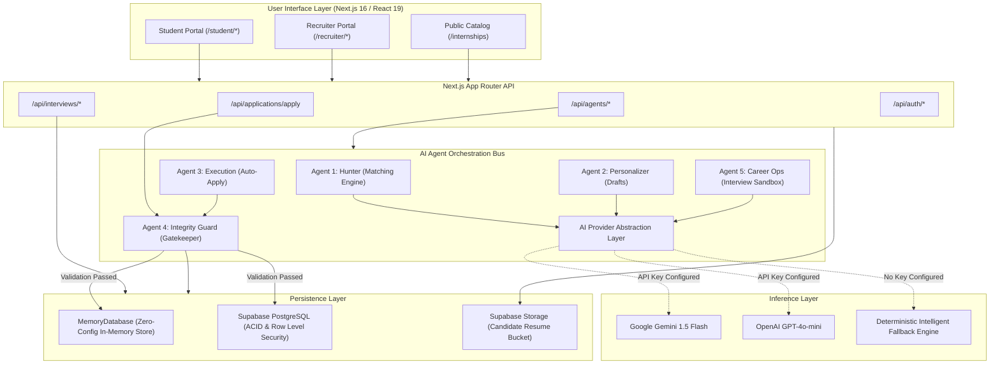
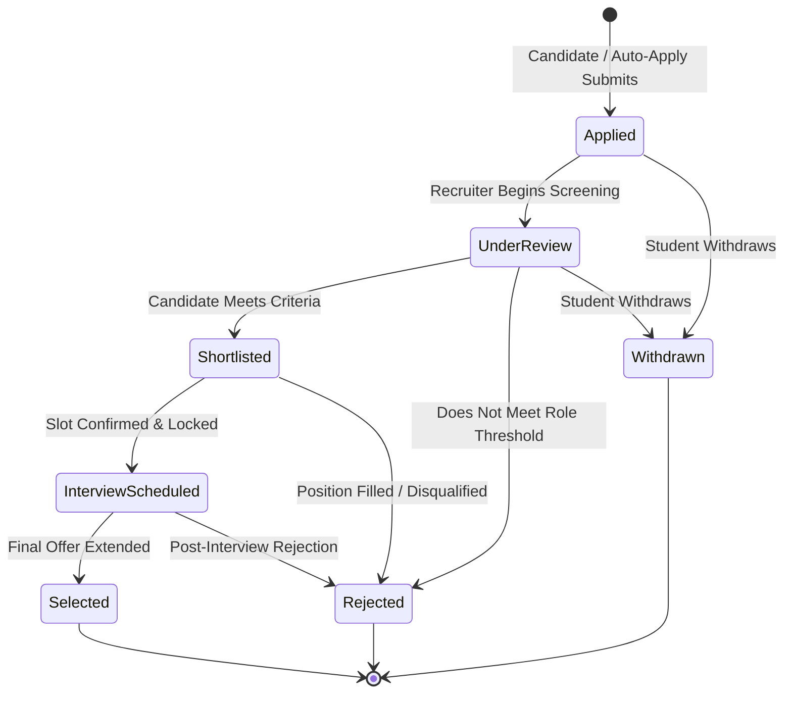

<p align="center">
  <a href="https://github.com/KjvRajesh11/internbridge">
    
  </a>
</p>

<p align="center">
  <strong>Intelligent Career &amp; Recruitment Platform</strong><br />
  <em>"Discover opportunities. Apply intelligently. Build your career."</em>
</p>

<p align="center">
  An AI-powered internship discovery and recruitment platform connecting students, recruiters, and intelligent career agents through one integrated application lifecycle.
</p>

<p align="center">
  <a href="https://nextjs.org/"></a>
  <a href="https://react.dev/"></a>
  <a href="https://www.typescriptlang.org/"></a>
  <a href="https://tailwindcss.com/"></a>
  <a href="https://supabase.com/"></a>
  <a href="https://vitest.dev/"></a>
</p>

<p align="center">
  <a href="#project-overview">Overview</a> •
  <a href="#core-features">Features</a> •
  <a href="#the-five-coordinated-ai-agents">Five AI Agents</a> •
  <a href="#product-architecture">Architecture</a> •
  <a href="#installation--local-development">Getting Started</a> •
  <a href="#automated-testing">Testing</a>
</p>

<p align="center">
  
</p>

---

## Project Overview

Early-career hiring is fragmented. Students submit identical resumes into black-box portals without knowing if their capabilities align with role requirements. Recruiters sift through duplicate submissions, parse unverified credentials, and coordinate interviews over chaotic email threads.

InternBridge unifies the early-career recruitment workflow into an auditable, transparent pipeline. It equips students with transparent compatibility scoring and AI interview rehearsal while providing recruiters with structured evaluation scorecards and atomic, conflict-free interview scheduling.

### The Official Problem Statement

> **Internship Application Portal:**  
> Create an internship portal where companies post internship opportunities and students apply online. Recruiters should manage applications, shortlist candidates, and schedule interviews. Students should track application progress from a dashboard.  
> **Key Rule: A student cannot apply to the same internship more than once.**

---

## Core Features

### Student Experience
- **Verified Candidate Profile**: Unified academic record declaring university, degree program, department, graduation year, and GPA.
- **Proof-of-Skill Portfolio**: Direct links to public GitHub project repositories, technical skills with verified proficiency levels, and certifications.
- **Resume Document Management**: Protected resume PDF storage and attachment with signed token retrieval.
- **Opportunity Search & Filters**: Search active postings by role title, required skills, company, or work mode (`remote`, `hybrid`, `in-office`).
- **Telemetry Application Tracker**: Real-time status updates across all lifecycle stages (`Applied`, `Under Review`, `Shortlisted`, `Interview Scheduled`, `Selected`, `Rejected`).
- **Submission Dossier & Follow-Up**: View past submissions, answers, and audit trails; trigger Agent 5 follow-up drafts when reviews remain pending over 7 days.
- **Interactive AI Mock Interview**: Rehearse with dynamic STAR-method behavioral and technical interview questions, receiving structured rubric evaluations.
- **Agent Control Center**: Configure auto-apply threshold sliders, set weekly application limits, and view execution logs.

### Recruiter Operations
- **Corporate Workspace Setup**: Manage company profile, industry classification, headquarters location, and brand overview.
- **Executive Posting Composer**: Publish internships with required competencies, preferred skills, compensation stipends, duration, and minimum GPA requirements.
- **Posting Lifecycle Control**: Manage opportunities across `draft`, `published`, `closed`, and `archived` states.
- **Applicant Directory**: Search and filter applicants with transparent compatibility match scores.
- **Candidate Dossier Review**: Review candidate GitHub repositories, submitted application statements, and verified resume PDFs.
- **Structured Evaluation Scorecards**: Record job-related rubric scores across Technical Knowledge, Problem Solving, and Communication with standardized recommendations.
- **Atomic Interview Scheduling**: Create recruiter availability slots and lock confirmed interviews with candidate meeting links without scheduling collisions.
- **Visual Kanban Board**: 6-column pipeline interface tracking candidate progression.
- **Recruitment Funnel Analytics**: Measure application volume, review dwell times, shortlist ratios, and offer acceptance rates.

### Application Integrity Safeguards

The core platform rule—**a student cannot apply to the same internship more than once**—is enforced across three architectural layers:

1. **Client Interface Layer**: Disables application triggers and displays active status badges when a candidate record exists.
2. **API Pre-Flight Layer**: Rejects duplicate submission requests at `/api/applications/apply` with HTTP 409 Conflict.
3. **Database Constraint Layer**: Enforces uniqueness via a PostgreSQL composite constraint:
   ```sql
   CONSTRAINT unique_student_internship UNIQUE (student_id, internship_id)
   ```
Application-layer validation alone cannot eliminate race conditions from concurrent browser tabs or automated scripts. The database-level constraint guarantees that duplicate submissions are rejected at the storage layer.

---

## The Five Coordinated AI Agents

InternBridge divides intelligent assistance into five focused domain services orchestrated through a central pipeline bus.

```
┌────────────────────────────────────────────────────────────────────────┐
│                        AGENT ORCHESTRATOR BUS                          │
└──────┬─────────────────┬─────────────────┬─────────────────┬───────────┘
       │                 │                 │                 │
       ▼                 ▼                 ▼                 ▼
  [ Agent 1 ]       [ Agent 2 ]       [ Agent 3 ]       [ Agent 4 ]
    Hunter        Personalization      Execution           Guard
(Match Engine)   (Draft Generator)    (Auto-Apply)     (Gatekeeper)
       │                 │                 │                 │
       └─────────────────┴────────┬────────┴─────────────────┘
                                  │
                                  ▼
                             [ Agent 5 ]
                             Career Ops
                          (Interview Prep)
```

### Agent 1 — Autonomous Internship Hunter
- **Function**: Discovers and ranks open opportunities against student profiles.
- **Deterministic 5-Factor Scoring**:
  $$\text{Match Score} = (0.40 \times S_{\text{req}}) + (0.20 \times S_{\text{pref}}) + (0.15 \times R) + (0.10 \times A) + (0.10 \times L)$$
  - **Required Skills Match** ($S_{\text{req}}$): 40%
  - **Preferred Skills Match** ($S_{\text{pref}}$): 20%
  - **Role & Title Alignment** ($R$): 15%
  - **Academic & GPA Eligibility** ($A$): 10%
  - **Location & Work Mode** ($L$): 10%
- **Transparent Output**: Explicitly breaks down matching skills versus missing skills.

### Agent 2 — Resume & Application Personalizer
- **Function**: Generates tailored cover letters, screening responses, and portfolio highlights.
- **Factual Integrity**: References only real project repositories and verified skills declared in the candidate's profile.
- **Zero Hallucination**: Does not fabricate degrees, grades, or work history.
- **Human Review**: Drafts are staged for candidate review and approval prior to submission.

### Agent 3 — Authorized Application Execution
- **Function**: Executes internal application workflows in two user-controlled modes:
  1. *Assisted Mode*: Pre-fills tailored materials for one-click manual submission.
  2. *Authorized Auto-Apply*: Submits applications automatically when compatibility meets or exceeds candidate-configured cutoffs (e.g., $\ge 80\%$) up to strict weekly caps.
- **Scope Restriction**: Submissions are restricted strictly to internal InternBridge postings; external job boards are not targeted.
- **Audit Logging**: Every execution event is immutably recorded in `agent_runs`.

### Agent 4 — Eligibility & Integrity Guard
- **Function**: Acts as the deterministic gatekeeper prior to application persistence.
- **Validation Suite**:
  - `duplicate_check`: Verifies that no prior application exists for `(student_id, internship_id)`.
  - `deadline_valid`: Confirms current timestamp is before `application_deadline`.
  - `gpa_eligible`: Verifies candidate GPA meets or exceeds `minimum_gpa`.
  - `cohort_eligible`: Confirms graduation year is accepted by the listing.
  - `status_active`: Confirms the internship is in `published` status.
- **Non-Bypassable**: Cannot be overridden by generative AI agents or client-side parameters.

### Agent 5 — Career Operations & Interview Preparation
- **Function**: Post-application tracking, dwell time analytics, and technical interview rehearsal.
- **Dwell Time Monitoring**: Calculates stage durations; flags applications under review for $>7$ days and drafts polite follow-up messages.
- **Interview Rehearsal Sandbox**: Generates role-specific technical and behavioral questions based on candidate projects and target requirements.
- **Structured Scoring**: Automatically scores mock answers against STAR rubrics (Situation, Task, Action, Result).

### AI Agent Comparison Matrix

| Agent | Core Purpose | Primary Responsibilities | Execution Mode |
| :--- | :--- | :--- | :--- |
| **Agent 1: Hunter** | Matching Engine | Scans listings, calculates 5-factor weighted scores, surfaces skill gaps | Deterministic Algorithm |
| **Agent 2: Personalizer** | Tailoring Assistant | Drafts tailored statements and screening responses from verified projects | Live LLM / Deterministic Fallback |
| **Agent 3: Execution** | Submission Pipeline | Handles assisted submission and authorized auto-apply with weekly caps | Automated Internal Service |
| **Agent 4: Guard** | Gatekeeper | Enforces single-application constraint, GPA cutoffs, and deadlines | Deterministic Hard Enforcement |
| **Agent 5: Career Ops** | Preparation Sandbox | Tracks dwell times, generates follow-ups, evaluates STAR mock answers | Live LLM / Deterministic Fallback |

---

## Product Architecture

### System Architecture Diagram



### Application Lifecycle State Machine



---

## Technology Stack

| Technology | Purpose in InternBridge |
| :--- | :--- |
| **Next.js 16** | Core App Router framework, Server Components, API routes, and static generation |
| **React 19** | Component architecture, Suspense boundaries, and modern UI hooks |
| **TypeScript 5** | Strict static type definitions across database schemas, API contracts, and domain models |
| **Tailwind CSS v4** | Editorial Black, White, and Red design system using `@tailwindcss/postcss` |
| **Supabase SSR** | Server client and cookie authentication helpers |
| **Supabase JS** | Client library for PostgreSQL queries, storage uploads, and schema migrations |
| **PostgreSQL 15+** | Relational database enforcing Row Level Security and composite unique constraints |
| **Google Gemini API** | Primary LLM provider for cover letter personalization and STAR mock interview evaluations |
| **Lucide React** | Minimalist icon set for workflow states and operational telemetry |
| **Vitest** | Automated test suite verifying business rules, duplicate rejection, and agent matching |
| **Zod** | Runtime schema validation for API payloads and form inputs |

---

## Application Screens & User Workflows

### Complete Route Directory

InternBridge includes **44 verified routes** (33 pages and 11 API endpoints):

| Route | Classification | Description |
| :--- | :--- | :--- |
| `/` | Public | Editorial landing page and dark product showcase |
| `/internships` | Public | Searchable internship catalog with work-mode filters |
| `/internships/[id]` | Public (Dynamic) | Internship specification and application trigger |
| `/features` | Public | Multi-agent architecture and governance documentation |
| `/how-it-works` | Public | End-to-end recruitment lifecycle guide |
| `/login` | Public / Auth | Authentication portal with 1-click evaluation demo persona switcher |
| `/register/student` | Public / Auth | Candidate onboarding capturing degree, institution, and GPA |
| `/register/recruiter` | Public / Auth | Employer workspace onboarding |
| `/privacy` | Public | Candidate data minimization and ethical AI policies |
| `/terms` | Public | Platform terms highlighting single-application rules |
| `/student/dashboard` | Student | Candidate operations hub with key metrics and recent applications |
| `/student/applications` | Student | Filterable application tracker with status history audit trail |
| `/student/applications/[id]` | Student (Dynamic) | Dossier review with submitted statement and Agent 5 follow-up generator |
| `/student/agents` | Student | Multi-agent control center with auto-apply threshold controls |
| `/student/interviews` | Student | Confirmed interview calendar with video links and prep launchers |
| `/student/interviews/[id]/prep` | Student (Dynamic) | Interactive AI mock interview sandbox with STAR rubric evaluation |
| `/student/profile` | Student | Academic credentials, target roles, and location preferences |
| `/student/portfolio` | Student | GitHub project portfolio, verified skills, and resume manager |
| `/student/notifications` | Student | Real-time alerts for stage transitions and application events |
| `/student/settings` | Student | Auto-apply preferences, weekly limits, and notifications |
| `/recruiter/dashboard` | Recruiter | Hiring control center with candidate intake metrics |
| `/recruiter/internships/new` | Recruiter | Role composer with deterministic requirements and GPA cutoffs |
| `/recruiter/internships` | Recruiter | Active listings inventory with applicant counters and status toggles |
| `/recruiter/internships/[id]/edit` | Recruiter (Dynamic) | Listing editor with status and requirements management |
| `/recruiter/applicants` | Recruiter | Candidate directory with compatibility match badges |
| `/recruiter/applicants/[id]` | Recruiter (Dynamic) | Candidate dossier with project viewer, resume download, and stage controls |
| `/recruiter/applicants/[id]/evaluate` | Recruiter (Dynamic) | Structured evaluation scorecard for technical and behavioral rubrics |
| `/recruiter/pipeline` | Recruiter | 6-column Kanban pipeline board across all application stages |
| `/recruiter/interviews` | Recruiter | Conflict-free interview scheduling workspace and slot booking |
| `/recruiter/analytics` | Recruiter | Recruitment funnel conversion metrics and stage distribution |
| `/recruiter/company` | Recruiter | Employer profile, branding, and headquarters configuration |
| `/recruiter/notifications` | Recruiter | Notification center for candidate submissions and interview updates |
| `/recruiter/settings` | Recruiter | Automated retention and candidate alert preferences |

---

## Project Structure

```text
internbridge/
├── .env.example                     # Environment template for local development
├── .env.local.example               # Alternative environment template
├── .vscode/
│   └── settings.json                # CSS language server configuration for Tailwind v4
├── docs/
│   └── screenshots/
│       ├── landing-page.jpg         # Verified platform interface screenshot
│       └── README.md                # UI screenshot capturing specifications
├── public/
│   ├── brand/
│   │   └── internbridge-logo.svg    # Official InternBridge SVG vector logo
│   └── file.svg, globe.svg, ...     # Static assets
├── src/
│   ├── app/                         # Next.js App Router pages and API routes
│   │   ├── api/                     # 11 REST API endpoints
│   │   │   ├── agents/              # Endpoints for Hunter, Personalize, Auto-Apply, Prep
│   │   │   ├── applications/        # Submission and status transition routes
│   │   │   ├── auth/                # Session and demo persona switching routes
│   │   │   └── interviews/          # Slot creation, scheduling, and feedback routes
│   │   ├── internships/             # Public discovery and listing detail pages
│   │   ├── recruiter/               # 13 Recruiter workspace pages
│   │   ├── register/                # Student and recruiter onboarding pages
│   │   ├── student/                 # 10 Student workspace pages
│   │   ├── globals.css              # Editorial Black/White/Red design system tokens
│   │   ├── layout.tsx               # Root layout with Demo Switcher, Navbar, and Footer
│   │   └── page.tsx                 # Editorial landing page
│   ├── components/                  # Shared UI components
│   │   ├── ApplyModal.tsx           # Application modal with integrity checks
│   │   ├── DemoSwitcher.tsx         # Instant 1-click persona switcher (Priya vs Alex)
│   │   ├── Footer.tsx               # Editorial footer with integrity guarantee
│   │   ├── Navbar.tsx               # Responsive editorial navigation bar
│   │   └── StatusBadge.tsx          # High-contrast application status chip
│   ├── lib/
│   │   ├── storage/
│   │   │   └── db.ts                # In-memory authoritative database & seed data
│   │   └── supabase/
│   │       ├── client.ts            # Supabase browser client factory
│   │       └── server.ts            # Supabase server client factory (cookie-aware)
│   ├── services/
│   │   └── agents/                  # The 5 domain AI agent implementations
│   │       ├── agent-orchestrator.ts # Central agent registry and bus
│   │       ├── ai-provider.ts       # LLM provider abstraction (Gemini / OpenAI / Offline)
│   │       ├── career-ops-agent.ts  # Agent 5 implementation
│   │       ├── execution-agent.ts   # Agent 3 implementation
│   │       ├── guard-agent.ts       # Agent 4 implementation
│   │       ├── hunter-agent.ts      # Agent 1 implementation
│   │       └── personalization-agent.ts # Agent 2 implementation
│   └── types/
│       └── index.ts                 # Authoritative TypeScript definitions
├── supabase/
│   ├── migrations/
│   │   └── 20261029000000_initial_schema.sql # 18 relational tables with RLS and constraints
│   └── seed.sql                     # Seed data for production Supabase deployments
├── tests/
│   └── internbridge.test.ts         # Vitest test suite (9 automated tests)
├── next.config.ts                   # Next.js configuration
├── package.json                     # Project manifest and npm scripts
├── postcss.config.mjs               # PostCSS configuration for Tailwind CSS v4
├── tsconfig.json                    # TypeScript compiler configuration
└── vitest.config.ts                 # Vitest test runner configuration
```

---

## Installation & Local Development

### Prerequisites
- **Node.js**: `v20.x` or later (tested on Node v20/v22)
- **npm**: `v10.x` or later
- **Git**

### Quickstart

1. **Clone the repository**:
   ```bash
   git clone https://github.com/KjvRajesh11/internbridge.git
   cd internbridge
   ```

2. **Install dependencies**:
   ```bash
   npm install
   ```

3. **Configure environment variables**:
   ```bash
   cp .env.example .env.local
   ```
   *InternBridge runs out of the box in zero-config demo mode without external services. See [Dual Persistence Modes](#dual-persistence-modes).*

4. **Start the development server**:
   ```bash
   npm run dev
   ```

5. **Open in browser**:  
   Visit [http://localhost:3000](http://localhost:3000).

### Environment Variables

| Variable | Required | Purpose | Fallback Behavior |
| :--- | :---: | :--- | :--- |
| `NEXT_PUBLIC_APP_URL` | No | Base application URL | Defaults to `http://localhost:3000` |
| `NEXT_PUBLIC_SUPABASE_URL` | Optional | Supabase project endpoint | Uses in-memory `MemoryDatabase` demo mode |
| `NEXT_PUBLIC_SUPABASE_ANON_KEY` | Optional | Supabase public API key | Uses in-memory `MemoryDatabase` demo mode |
| `SUPABASE_SERVICE_ROLE_KEY` | Optional | Supabase administrative key | Only needed for administrative database migrations |
| `GEMINI_API_KEY` | Optional | Google Gemini 1.5 Flash API Key | Uses deterministic intelligent fallback engine |
| `OPENAI_API_KEY` | Optional | OpenAI API Key (alternative) | Evaluated if `GEMINI_API_KEY` is not provided |

### Dual Persistence Modes

1. **Zero-Config Demo Mode (Default)**:
   - Operates entirely in memory via `src/lib/storage/db.ts` with pre-seeded data.
   - Fully supports application submissions, recruiter status transitions, interview slot locks, and agent runs.
   - Use the **Demo Switcher bar** at the top of any page to toggle instantaneously between:
     - **Priya Sharma (Student)**: NIT B.Tech, 8.85 GPA, Full Stack Engineer
     - **Alex Rivera (Recruiter)**: CloudScale Technologies, Lead Technical Recruiter
   - Requires zero external database or cloud account setup.

2. **Configured Supabase Mode**:
   - Activated automatically when `NEXT_PUBLIC_SUPABASE_URL` and `NEXT_PUBLIC_SUPABASE_ANON_KEY` are supplied.
   - Connects to PostgreSQL using the schema defined in `supabase/migrations/20261029000000_initial_schema.sql`.
   - Enforces PostgreSQL Row-Level Security policies and storage bucket rules.

---

## Running the Application

| Command | Script in `package.json` | Action |
| :--- | :--- | :--- |
| `npm run dev` | `next dev --webpack` | Starts the Next.js development server on port 3000 |
| `npm run build` | `next build --webpack` | Runs type checks and creates an optimized production build across all 44 routes |
| `npm start` | `next start` | Runs the compiled production server |
| `npm test` | `vitest run` | Executes the automated Vitest test suite |
| `npm run lint` | `eslint` | Runs ESLint across all source files |

---

## Security & Data Governance

1. **Defense-in-Depth Duplicate Prevention**:
   - Client-side button state guards.
   - Server-side pre-flight checks (`guardAgent.evaluateEligibility()`) returning HTTP 409.
   - PostgreSQL composite unique constraint (`UNIQUE (student_id, internship_id)`).
2. **Server-Side Authorization**:
   - Recruiter operations verify that the authenticated user belongs to the company owning the target internship.
   - Students cannot view or modify application records of other candidates.
3. **No Hallucinated Credentials**:
   - Agent 2 operates with bounded context: it can only reference projects, skills, and metrics present in the candidate's verified profile.
4. **PostgreSQL Row Level Security (RLS)**:
   - 18 comprehensive policies in `supabase/migrations/20261029000000_initial_schema.sql` restrict table queries based on `auth.uid()`.
5. **Secret Hygiene**:
   - Zero hardcoded credentials; all secrets are consumed strictly via server-side environment variables.

---

## Automated Testing

InternBridge includes an automated test suite executed via Vitest, verifying core business rules, integrity guards, and agent matching logic:

```bash
$ npm test

 ✓ tests/internbridge.test.ts (9 tests) 31ms
   ✓ InternBridge Core Platform & AI Agent Verification (9)
     ✓ 1. Non-Negotiable Business Rule: One Application Per Internship (4)
       ✓ allows a student to submit their first application to an internship (1ms)
       ✓ strictly REJECTS a duplicate application for the same student-internship pair (0ms)
       ✓ allows the same student to apply to a DIFFERENT internship (0ms)
       ✓ allows two DIFFERENT students to apply to the SAME internship (0ms)
     ✓ 2. Agent 1: Autonomous Internship Hunter & Deterministic Matching (1)
       ✓ calculates weighted compatibility score and surfaces matching vs missing skills (1ms)
     ✓ 3. Agent 4: Eligibility & Integrity Guard (2)
       ✓ blocks applications that fail the minimum GPA requirement (0ms)
       ✓ blocks applications when the deadline has expired (27ms)
     ✓ 4. Application Status Lifecycle & History Audit (1)
       ✓ updates application status and appends immutable history audit event (0ms)
     ✓ 5. Interview Scheduling & Conflict Prevention (1)
       ✓ schedules an interview and atomically locks the slot (0ms)

 Test Files  1 passed (1)
 Tests       9 passed (9)
 Duration    138ms
```

### Test Suite Coverage Breakdown

| Test Area | Tested Behavior | Verification Status |
| :--- | :--- | :---: |
| **Duplicate Prevention** | Verifies first application succeeds; duplicate submission for same pair throws error | ✅ Verified Pass |
| **Cross-Entity Submission** | Confirms a student can apply to multiple internships, and multiple students to one | ✅ Verified Pass |
| **Agent 1: Matching** | Validates 5-factor weighted formula and skill overlap calculation | ✅ Verified Pass |
| **Agent 4: GPA Guard** | Confirms candidates below `minimum_gpa` cutoff are deterministically blocked | ✅ Verified Pass |
| **Agent 4: Deadline Guard** | Confirms postings with expired timestamps cannot accept submissions | ✅ Verified Pass |
| **Status Audit History** | Confirms status transitions append immutable records to audit log | ✅ Verified Pass |
| **Interview Slot Lock** | Verifies atomic booking of interview slots and rejection of double-booking | ✅ Verified Pass |

---

## Product Roadmap

### Core Platform (Implemented)
- [x] Full-stack Next.js 16 App Router architecture with React 19 and Tailwind CSS v4.
- [x] Comprehensive 44-route directory covering public, student, and recruiter flows.
- [x] Three-tier duplicate application prevention (`UNIQUE (student_id, internship_id)`).
- [x] Conflict-free atomic interview scheduling and slot management.
- [x] Candidate dossier viewer with verified project links and original resume access.
- [x] Multi-persona demo switching bar for instantaneous evaluation.

### AI Intelligence (Implemented)
- [x] Agent 1: 5-factor weighted deterministic opportunity matching engine.
- [x] Agent 2: Factual resume and cover letter personalization without hallucinations.
- [x] Agent 3: Authorized internal auto-apply with weekly caps and threshold sliders.
- [x] Agent 4: Deterministic gatekeeper enforcing GPA, deadlines, and single-application rules.
- [x] Agent 5: Stage dwell-time analytics and interactive STAR mock interview sandbox.

### Future Enhancements (Planned)
- [ ] **Natural-Language Career Command Center**: Conversational agent allowing students to query opportunities using natural language queries.
- [ ] **Skill Gap Learning Paths**: Recommending specific open-source projects or coursework to bridge missing skill requirements identified by Agent 1.
- [ ] **Recruiter AI Copilot**: Automated summarization of candidate project commits and code quality metrics.
- [ ] **External Job Board Connectors**: Permitted API integrations with external university career services and verified job portals.

---

## Contributing

Contributions to InternBridge are welcome. Please adhere to the following workflow:

1. **Fork the Repository** on GitHub.
2. **Create a Feature Branch**:
   ```bash
   git checkout -b feature/your-feature-name
   ```
3. **Write Clean, Tested Code**:
   - Ensure all code conforms to TypeScript strict mode.
   - Maintain the editorial black/white/red design system without introducing arbitrary colors.
   - Add unit tests for new business logic or agent capabilities in `tests/`.
4. **Run Verification Commands**:
   ```bash
   npm test
   npm run build
   ```
5. **Submit a Pull Request**: Provide a detailed description of changes and test outcomes.

---

## License

No license has been specified yet for this repository. All rights are reserved by the author.

---

## Acknowledgements

- **Next.js & React Teams** at Vercel and Meta for Next.js 16 and React 19.
- **Tailwind Labs** for the high-performance Tailwind CSS v4 engine.
- **Supabase** for PostgreSQL developer tooling and Row Level Security architecture.
- **Google DeepMind** for the Gemini generative AI platform.
- **Lucide** for the open-source icon collection.

---

## Contact

- **Project Repository**: [https://github.com/KjvRajesh11/internbridge](https://github.com/KjvRajesh11/internbridge)
- **Maintainer**: [KjvRajesh11](https://github.com/KjvRajesh11)
